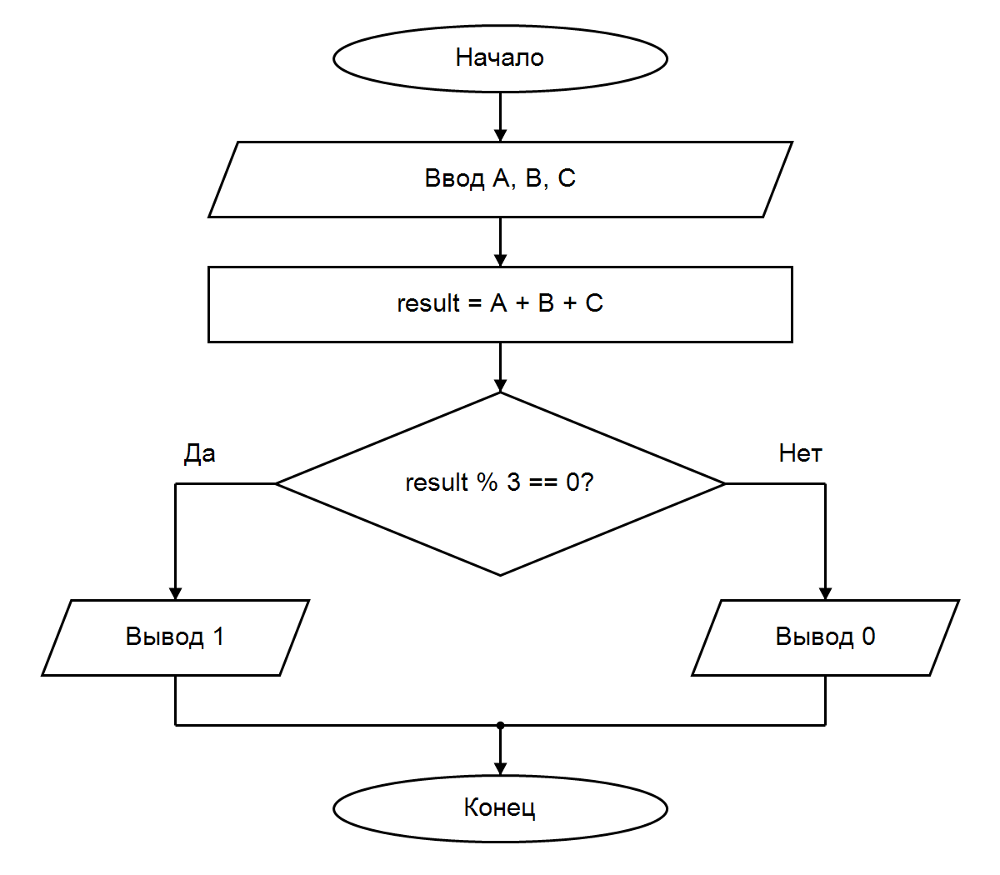

# Домашка к 4 лабе

### Вариант 6

Команда мечты. Тройка игроков счастливая, если сумма номеров A, B и C делится на 3 без остатка.

Вывод: написана программа на C с условием if/else. Если сумма номеров делится на 3 без остатка, выводится 1, иначе — 0.
